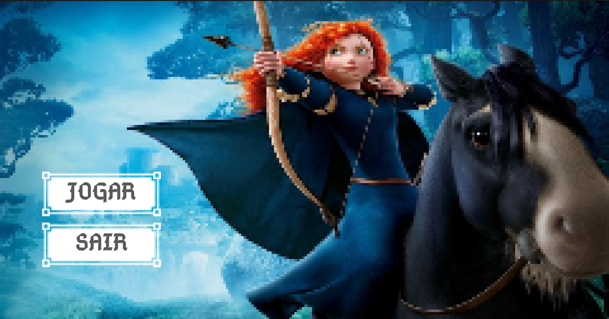
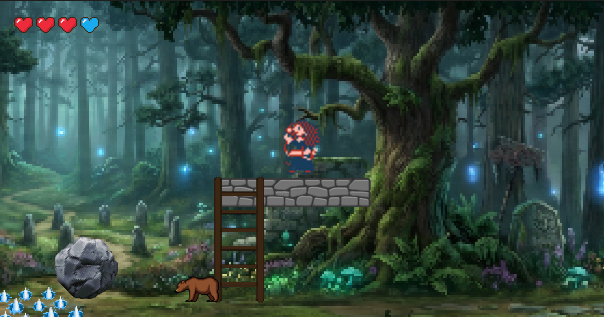
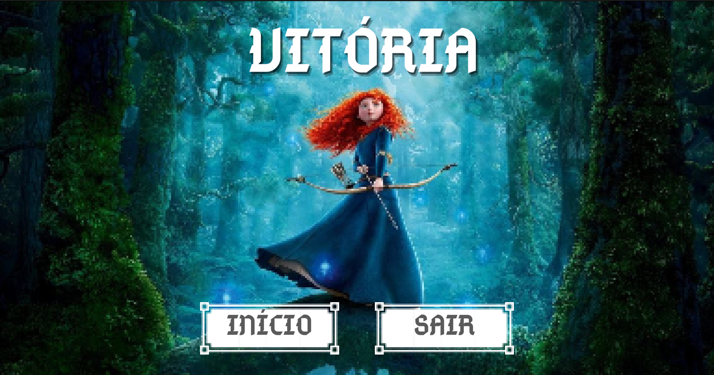
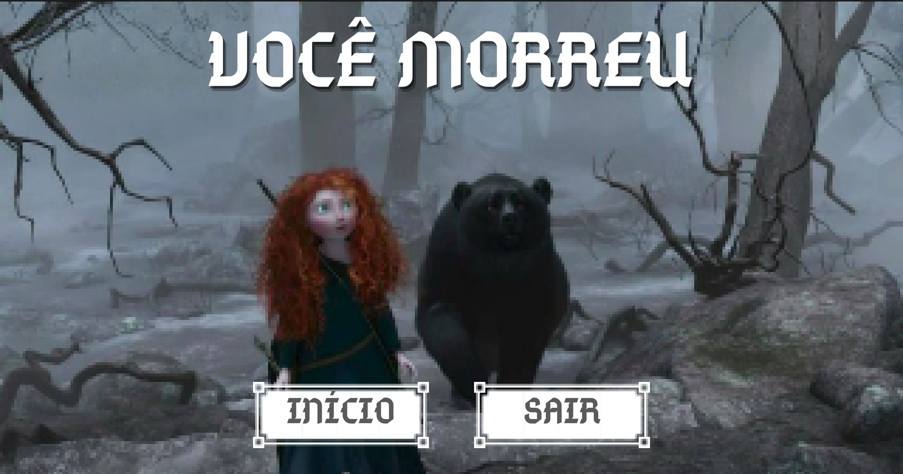

# Jogo "Valente"

Jogo de plataforma temático de *Valente*, desenvolvido como trabalho
final da disciplina de **Programação 2 (CI1002)** da Universidade Federal 
do Paraná. Desenvolvido em C com a biblioteca Allegro 5.

## Sobre

O jogador controla a personagem Merida desviando de obstáculos e coletando 
itens pelo caminho. O objetivo é sobreviver até a linha de chegada.

### Mecânicas do jogo

- **Movimentação:** teclas WASD ou setas (↑ ↓ ← →)
- **Pulo:** tecla de espaço
- **Pausa:** tecla P
- **Retorno à tela inicial:** tecla ESC
- **Wisp:** item que fornece vida extra
- **Urso:** obstáculo com interação especial
- **Rolling background:** cenário com rolagem contínua
- **HUD:** exibição de vidas restantes. Há um total de 3 vidas + vida extra

## Telas

### Tela inicial

### Tela de jogo

### Tela de vitória

### Tela de derrota

## Ferramentas

- **Linguagem:** C (padrão C99)
- **Biblioteca:** Allegro 5
- **Compilação:** Makefile com `-Wall -g` e `pkg-config`
- **Programas auxiliares:** Valgrind (verificação de memória), Git

## Como compilar e executar

    make
    make run

Ou,

    make
    ./main

Para verificar vazamentos de memória:

    make valgrind

Para limpar os arquivos objeto e executável gerados:

    make clean

Para compactar os arquivos:

    make tgz

## Assets

Os recursos visuais e sonoros utilizados no jogo incluem:

- **Imagens de fundo:** tela inicial e cenário do jogo
- **Sprites:** Merida, urso, wisp e obstáculos
- **Fonte:** `Abibas.ttf`
- **Áudios:** músicas para cada tela

## Créditos

Projeto idealizado pelos professores **Diego Addan** e **Andrey Pimentel**, para a disciplina CI1002 da UFPR.

Implementação desenvolvida por **Isabella dos Santos Stuart**.
